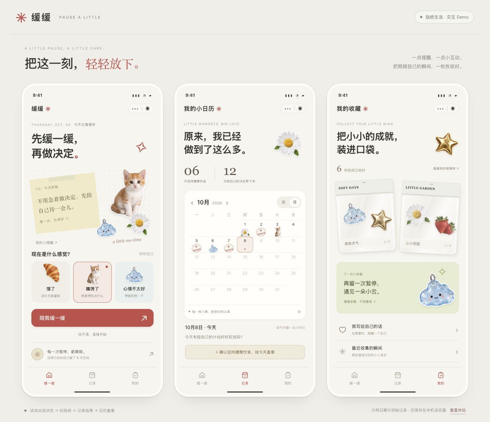
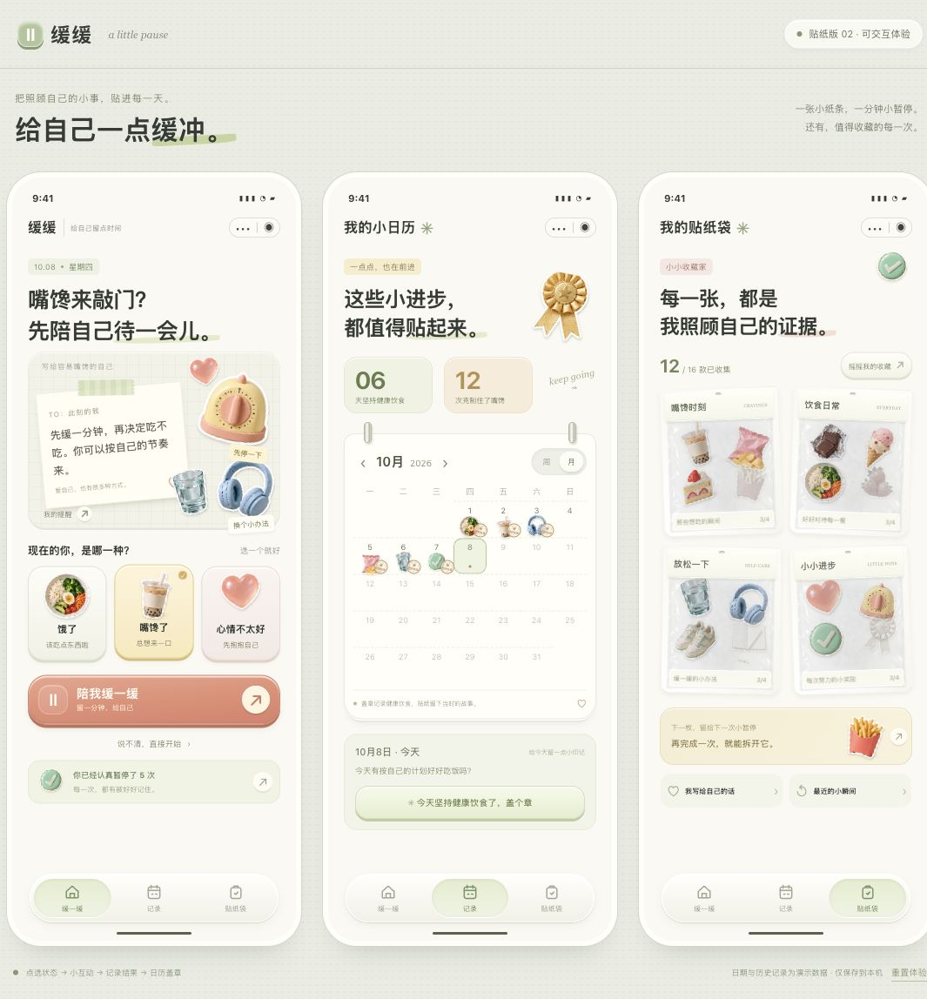
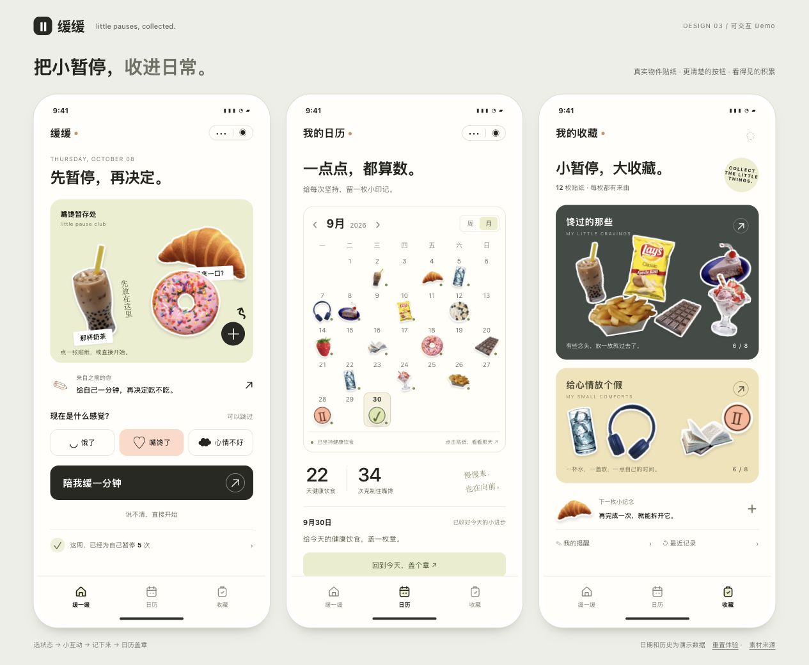
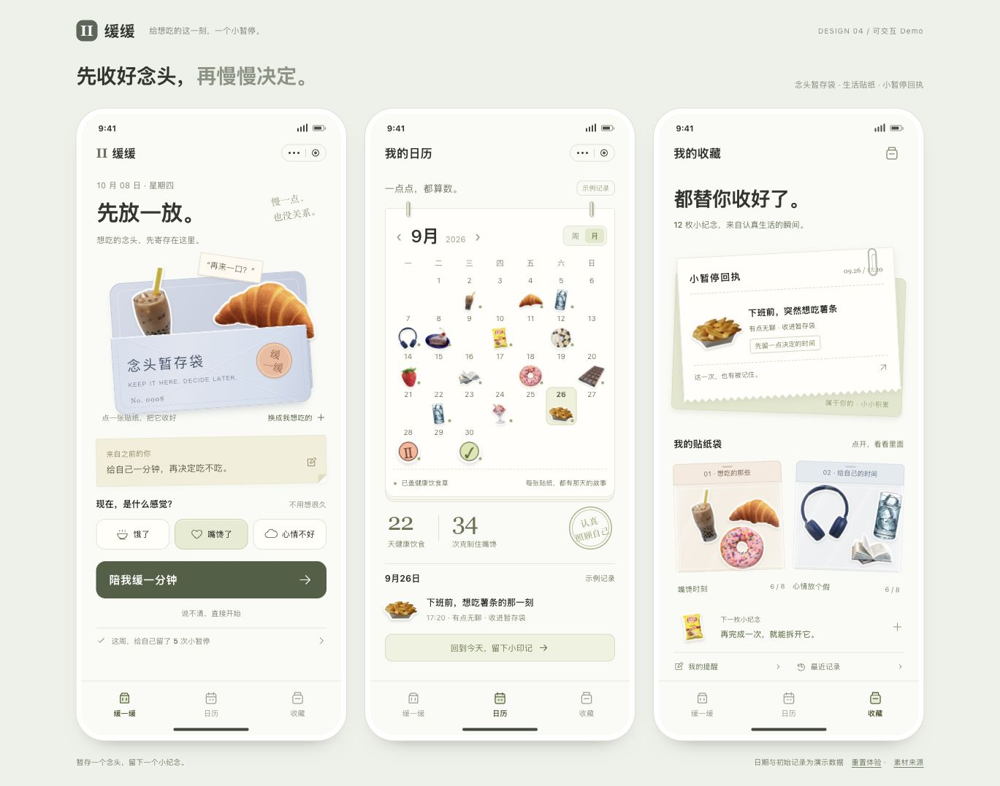
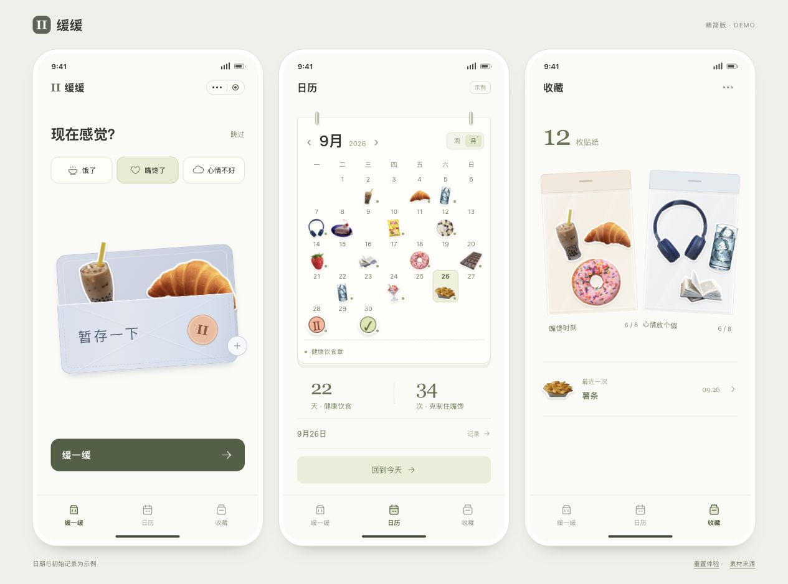
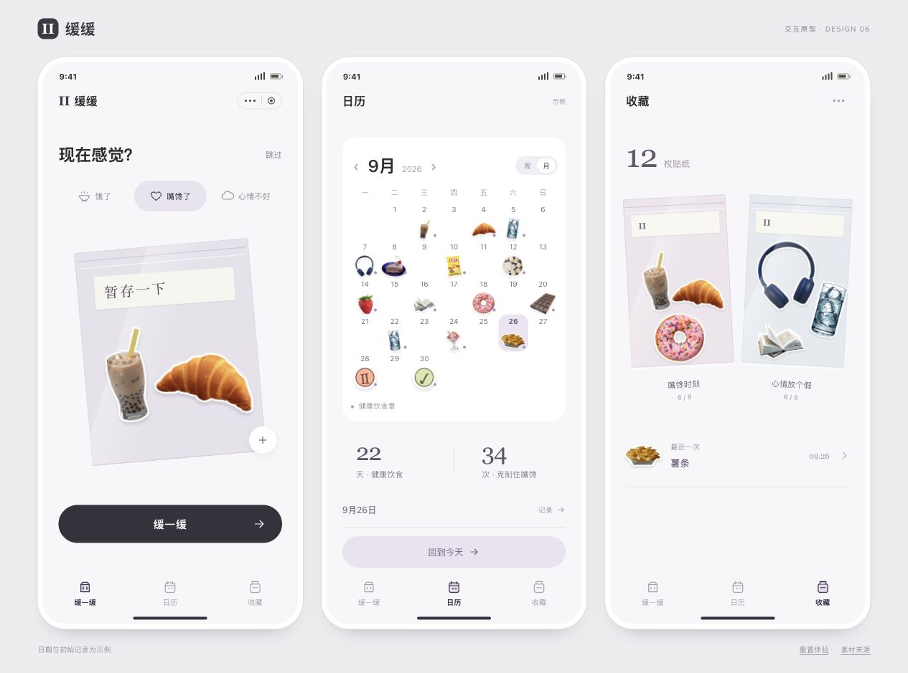

# 缓缓的六版设计记录

[打开 Demo 展厅](https://zhengzizhen-zzz.github.io/huanhuan/evolution.html) · [产品故事](CASE-STUDY.md) · [当前版本](https://zhengzizhen-zzz.github.io/huanhuan/)

这些旧稿都来自项目实际保留的版本。前五版可以独立打开，第六版使用当前公开版。改动来自持续设计评审，记录的是设计选择，不是用户实验结果。

## 01 先把可爱的感觉做出来

贴纸、纸条、日历和收藏都有了，但猫和云朵为什么出现在这里，还说不清。

早期加入猫、花和鼓励文案，希望传达陪伴感。

这版留下了三页结构，也暴露了问题：装饰很多，和食欲场景的关系却不够明确。

[打开这一版 Demo](https://zhengzizhen-zzz.github.io/huanhuan/demo-v1.html)

## 02 拿掉猫，换成日常物件

“贴纸太少了……为什么会有猫。”

换成食物、水杯、耳机和小进步贴纸；扩充到四组收藏，统一按钮反馈。

物件更贴近场景了，但首页仍摆着纸条、状态、主按钮和统计；按钮的厚重感也不符合预期。

[打开这一版 Demo](https://zhengzizhen-zzz.github.io/huanhuan/demo-v2.html)

## 03 贴纸终于可以直接点了

“你直接去贴纸网站复制不就好了。”

改用有来源说明的透明食物照片，减少厚渐变按钮。点击奶茶、面包，就能开始互动。

真实食物让“我想吃什么”更具体；三页还需要一个共同的动作，让视觉与流程连起来。

[打开这一版 Demo](https://zhengzizhen-zzz.github.io/huanhuan/demo-v3.html)

## 04 把念头先收进袋子

从点一张食物贴纸，到收好这一次念头。

首页采用暂存袋，支持点击和向下拖入；日历记下结果，收藏页留下一张小暂停回执。

主题开始连贯，但同时出现的说明、提醒和次要入口太多。页面越完整，第一步反而越不突出。

[打开这一版 Demo](https://zhengzizhen-zzz.github.io/huanhuan/demo-v4.html)

## 05 东西没少，先收起来一些

“很多文字指引……很杂乱。”

删除重复标题、说明与周统计；日期详情默认收起，提醒、历史和贴纸球进入菜单。

首页剩下状态、暂存袋和主按钮。功能需要时还找得到，默认画面不必把一切都讲完。

[打开这一版 Demo](https://zhengzizhen-zzz.github.io/huanhuan/demo-v5.html)

## 06 继续拿掉多余的框

“那个框看起来太 AI 了。”

减少状态描边、日历装订环和纸张叠层，保留贴纸与袋子作为主要视觉。

这是当前公开版：沿用第六版布局，袋子使用代码绘制的替代材质。接下来观察用户会不会自然点击、能否找到第一步。

[打开这一版 Demo](https://zhengzizhen-zzz.github.io/huanhuan/index.html)

## 下一次要看真实操作

不先讲解，看看用户会不会点食物、能不能找到跳过、能否理解结果记录。再观察日历和收藏是否让人愿意回来。好看是开始，下一步要检查这些具体行为。

截图中的日期与数字为示例。前两版使用 AI 辅助生成素材，第三版起使用有署名的现成食物照片。第六版原始袋子材质不随仓库分发，展厅使用公开版截图和 Demo。详见 [素材说明](ASSETS.md)。
