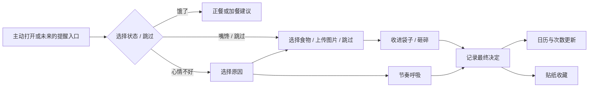

# 缓缓 Huanhuan

**想吃东西的那一刻，给自己一点决定的时间。**

缓缓是围绕嘴馋与情绪性进食场景设计的产品原型：通过状态选择、短时趣味互动与替代行动，帮助用户暂缓冲动；通过日历盖章、次数记录与贴纸收藏，让每次尝试被看见。

本仓库是 **产品经理 / AI 产品经理作品集项目**，围绕问题定义、场景拆解、MVP 取舍、交互设计和验证方法展开。当前交付物为移动端优先的 Web Demo，产品形态规划为小程序。

> 当前没有接入大模型、RAG、食物识别或通知服务，也没有证明产品能改善食欲或降低暴食发生率。


## 产品案例导览

建议先阅读 [产品案例：问题、决策与下一步验证](CASE-STUDY.md)，再体验原型。项目重点是产品判断及其依据，前端代码用于让方案可体验、可讨论。

## 快速体验

下载仓库后，用浏览器打开 `index.html` 即可体验，无需安装依赖、登录或填写密钥。

需要本地服务器时，在项目目录运行：

```bash
python3 -m http.server 8000 --bind 127.0.0.1
```

然后打开 `http://127.0.0.1:8000`。手机尺寸显示单页与底部导航，宽屏同时展示三个主要页面。

## 解决什么问题

目标场景是：用户在工作、学习间隙，因为压力或无聊想找零食、浏览外卖，却又希望先缓一缓。产品尝试在“想吃”到“决定吃”之间提供一次简短、低操作负担的介入。

第一阶段优先研究压力驱动与无聊驱动两种场景。同一个人可能在不同时间经历两种状态，因此按当次需求分流，不给用户贴固定标签。

## 已实现与规划

| 模块 | 当前 Demo | 后续需求 |
| --- | --- | --- |
| 状态选择 | 饿了／嘴馋／心情不好，可跳过 | 验证状态分流是否增加负担 |
| 个人提醒 | 编辑提醒文字，并在食物选择页展示 | 首次引导、图片提醒、展示时机测试 |
| 食物输入 | 常见食物选择、自定义文字、本地图片预览 | 食物识别、份量确认、营养数据来源 |
| 即时互动 | 收进袋子、点击砸碎、节奏呼吸 | 更多互动、场景化替代行动、模拟点外卖探索 |
| 结果记录 | 暂时不吃／吃了／未决定 | 提醒后补记、真实日期与跨设备同步 |
| 日历反馈 | 周／月视图、当天盖章、次数统计 | 跨日连续使用与统计规则验证 |
| 贴纸收藏 | 互动奖励、收藏袋、贴纸球、最近记录 | 可持续的成长规则与内容更新 |
| 主动触达 | 未实现 | 用户指定时段提醒、平台能力验证 |
| AI 能力 | 未实现 | 基于审核知识库的场景建议与效果评估 |

## 核心流程



## 关键产品取舍

- **减少打开后的操作**：状态和食物都可以跳过；首页贴纸支持直接互动。
- **区分饥饿与嘴馋**：饥饿分支提供进食建议，避免一律要求忍住。
- **记录决定，而非只收集“成功”**：吃了、没吃、尚未决定都可记录。
- **每日章和单次记录分开**：一次没吃零食，不等于全天健康饮食。
- **先验证入口，再扩展内容**：最大的待验证问题是用户会不会在冲动发生时打开产品。
- **将 AI 用在有需要的地方**：动画与计数使用确定性逻辑，场景建议再考虑检索与生成。

## 项目文档

- [产品经理案例复盘](CASE-STUDY.md)
- [需求定义与范围](PRD.md)
- [需求验证计划](VALIDATION.md)
- [AI / RAG / Harness 规划](AI-ROADMAP.md)
- [运行与验收说明](TESTING.md)
- [素材来源与授权](ASSETS.md)

需求与产品方向由项目发起者提出并迭代，文档整理、前端实现和检查使用 AI 辅助。第三方照片的作者及来源单独列出。

## 技术实现

原生 HTML、CSS 和 JavaScript，无构建依赖。通过 Pointer Events 支持拖动，CSS 动画呈现交互，`localStorage` 保存本机体验记录。图片仅通过浏览器对象 URL 本地预览，不会上传服务器，刷新后不保留原图。

核心文件：`index.html`（页面）、`style.css`（视觉）、`app.js`（交互与状态）、`asset-sources.json`（照片来源）。PNG 资源放在根目录，便于直接打开和静态托管。

## 当前限制

- 日期固定为 **2026-10-08**，初始的 22 天、34 次和 12 枚贴纸为演示数据，不能作为用户使用成果。
- 数据不跨设备同步；历史面板仅展示最近五条体验记录。
- 未完成微信小程序适配、提醒服务或后端开发。
- 本产品原型不提供疾病诊断或治疗，也不使用“少吃一次就避免某种疾病”的承诺。
- 公开版保留交互流程，包装袋改用 CSS 样式；不分发原本禁止上传仓库的第三方袋子纹理。

## 使用范围

代码公开用于作品集阅读与体验；尚未为原创代码及文档授予统一开源许可证。第三方图片按其各自授权使用，不因仓库公开而成为可任意商用的素材，详见 [ASSETS.md](ASSETS.md)。
