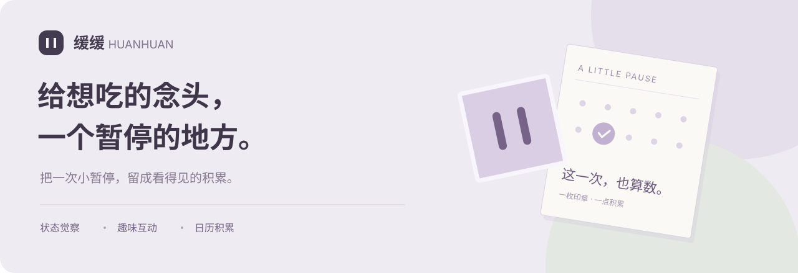

<a href="https://zhengzizhen-zzz.github.io/huanhuan/"><b>打开缓缓 ↗</b></a> &nbsp; · &nbsp;
<a href="https://zhengzizhen-zzz.github.io/huanhuan/evolution.html"><b>看看它怎么改到今天 ↗</b></a> &nbsp; · &nbsp;
<a href="RESEARCH.md">调研摘记</a> &nbsp; · &nbsp;
<a href="PRD.md">PRD</a>

# 缓缓 Huanhuan

下午的任务卡住了，想点杯奶茶。晚上没什么事，翻了好几遍外卖。知道自己未必饿，却还是想找点东西吃。

**缓缓想帮忙的，就是这个瞬间。**

把想吃的食物拖进袋子，砸一砸，或者跟着节奏呼吸。先做一个小动作，再决定吃不吃。之后，日历留下一次记录，收藏袋多一枚贴纸。回来看时，能知道自己哪一天尝试过、缓住过多少次。

[**直接体验**](https://zhengzizhen-zzz.github.io/huanhuan/) · 当前是面向小程序设计的 Web 交互原型，手机和电脑都能打开。

## 最开始 我想做一个帮人管住嘴的工具

早期的功能清单很长：砸碎零食、模拟点外卖、拍照看热量、积分、养宠物、定时提醒……每个点子都有吸引力，但放在一起，很难说清用户打开后该先做什么。

于是先把范围缩到两种时刻：**压力大，想靠吃东西喘口气；无聊，嘴巴总想找点事。** 同一个人可能都会遇到。用户也可以选择“饿了”，转去安排进食，不必把每次想吃都当成需要克制的事。

三轮小红书公开内容调研阅读了 **72 篇去重帖子详情**。其中有对虚拟点单的期待，也有“玩完还是想下单”的反例。这让一些有趣的点子留在了待验证清单里。[阅读调研摘记](RESEARCH.md)

## 六版 Demo 留下了几次方向调整

> “贴纸太少了……为什么会有猫。”
>
> “很多文字指引……很杂乱。”

这两条设计反馈之间，缓缓改了好几轮。猫被拿掉，食物贴纸换成现成照片；贴纸从装饰变成入口，奶茶可以直接收进袋子。后来又发现，纸条、说明和统计一起摆出来，反而抢走了主动作的注意力，于是开始删。

| 早期的第二版 | 当前公开版 |
| --- | --- |
|  |  |
| 想靠更多贴纸和鼓励文字，把页面做得可爱。 | 保留可以玩的物件，把暂时不需要的信息收起来。 |

[**打开六版 Demo 展厅：看大图，也可以逐版操作 →**](https://zhengzizhen-zzz.github.io/huanhuan/evolution.html)

## 现在保留下来的体验

- **缓一缓**：选状态，也可以跳过；点击首页食物就能开始。支持暂存、砸碎、呼吸，以及自己的提醒文字。
- **日历**：记录吃了、暂时不吃或还没决定；按周、按月回看。单次克制次数和全天健康饮食章分开计算。
- **收藏**：完成互动后留下贴纸，打开袋子能看到积累。吃了也可以记录，再回来尝试。

一个还没解决的问题是：**想吃的时候，用户真的会记得打开它吗？** 这也是下一轮试用最先要观察的事。定时提醒、更多动画和 AI 建议，都要围绕这个真实使用过程继续做。

## 继续往下看

| 想了解什么 | 从这里开始 |
| --- | --- |
| 为什么做，哪些点子留下了，哪些暂缓 | [产品故事与取舍](CASE-STUDY.md) |
| 三轮调研看到了什么，反例是什么 | [用户研究](RESEARCH.md) |
| 每一版改在哪里，为什么改 | [设计记录](DESIGN-STORY.md) · [Demo 展厅](https://zhengzizhen-zzz.github.io/huanhuan/evolution.html) |
| 具体功能、数据规则与验收方式 | [PRD](PRD.md) |
| 下一步怎么验证入口、帮助感和回访 | [试用计划](VALIDATION.md) |
| AI 准备用在哪，怎样检查回答质量 | [RAG 与 Harness 方案](AI-ROADMAP.md) |

当前进度与运行说明

原型已能在浏览器中完成互动、记录、盖章与收藏。日期和初始数字为演示数据；新增记录仅存在本机浏览器，照片只做本地预览。微信适配、通知、食物识别与 AI 服务尚未接入。

下载后打开 `index.html`，或运行 `python3 -m http.server 8000 --bind 127.0.0.1`。原生 HTML / CSS / JavaScript，无构建依赖。历史版本入口为 `demo-v1.html` 至 `demo-v5.html`，使用独立存储键。运行检查见 [TESTING.md](TESTING.md)。

项目分工与素材

项目发起者提出问题，决定功能优先级与体验方向，并持续评审、推动修改。资料整理、文档和前端实现使用 AI 辅助。第三方图片单独署名，使用范围见 [ASSETS.md](ASSETS.md)。

